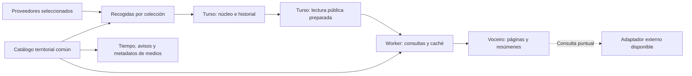

# Agenda, deportes y territorio: base y contrato de servicios

25/10/2026. Revisión actualizada tras el primer incremento territorial y la
preparación de [lectura SQL y rutas CF/Deno](api-lectura.md) del PR 144.
Este documento reúne la organización de datos, sus relaciones y los criterios
de servicio. Sustituye el orden de trabajo anterior: se prioriza cerrar la base
antes de ampliar proveedores o activar la nueva lectura. Los contratos y tablas
que se describen como propuestos requieren implementación posterior; esta revisión
no migra datos, activa rutas ni detiene las recogidas existentes.

El [inventario de relaciones y códigos](inventario-relaciones.md) distingue
los vínculos implementados de los propuestos y reúne las fuentes oficiales de
contraste. Se mantienen las recogidas culturales actuales por la evidencia que
conservan, según lo aclarado con el usuario; se posponen las ampliaciones mientras
se cierra el modelo. Los cruces NORA deben incluir Navarra, presente en nuestras
muestras, además de Euskadi.

El [contrato del relacionador territorial](../shared/territorios/relacionador.md)
concreta referencias, tipos, evidencia, vigencias y reglas de recorrido. El
primer incremento añade países ISO y `pais_catalogo` para medios, distinto de
cobertura editorial; la persistencia y los recorridos del contrato son propuestas.

## Alcance aclarado con el usuario

- Primera fase deportiva: calendarios, resultados y clasificaciones con
  recogidas periódicas. Los marcadores en directo quedan para después.
- Municipios como primer paso hacia códigos comunes y reutilizables entre
  servicios. La interfaz para fijar o seguir recintos sigue sin decidir.
- Se conservan los recintos acreditados que ya aportan las fuentes, sin
  exigirlos para importar un evento. La búsqueda por distancia queda fuera
  de esta primera fase.
- Las noticias propias se seleccionan entre las cargadas en memoria desde R2;
  Google News aporta consultas externas y noticias relacionadas. Se mantiene
  ese funcionamiento y se posponen los enlaces persistentes noticia–entidad.
- Acuerdo de esta revisión: la cobertura de los medios admite varios municipios
  y provincias acreditados; se conserva la región como información disponible
  para los demás. La clasificación detallada de cada medio requiere evidencia.
- Se termina primero el contrato y la operación de lo existente. Las muestras
  deportivas sirven para contrastar relaciones; no se añade un proveedor solo
  para poder diseñar la base.

## Qué hay y dónde aparece el límite

| Parte | Comprobado en el código | Consecuencia |
| --- | --- | --- |
| Navegador | `front/app/14-calendario.js` descarga `calendario.json` y construye filtros y vistas sobre todo el conjunto. | Paginar visualmente no reduce descarga ni memoria de datos. |
| Rendimiento local | El PR 141 reutiliza `Intl`, evita conversiones y ordenaciones repetidas y conserva el catálogo de filtros. | Es una mejora aprovechable. La medición de 3.724 eventos/9,6 MB no acredita rendimiento remoto. |
| Lectura preparada | El PR 144 añade proyección SQL y rutas CF/Deno. El frontend sigue con JSON; la publicación SQL es optativa. | Se conserva para revisión: faltan clasificaciones, cobertura por colección y medición real antes de conectar el cliente. |
| Estado | Turso dedicado, esquema 4, núcleo v2 con entidades, referencias, observaciones, relaciones y selección por bloques. | Ya existe el modelo de escritura; conviene ampliarlo. |
| Lectura de la base | `almacen.CONSULTAS` y `almacen_nucleo.CONSULTAS` cargan colecciones completas, incluidos documentos y observaciones. `nucleo.consultar` trabaja en memoria. | Reutilizar esa carga en cada petición trasladaría el problema al servidor. Las recogidas también crecerían con el historial. |
| Índices | Hay fechas civiles/UTC en `agenda_tiempos`. Las tablas `agenda_evento_tema` y `agenda_evento_region` corresponden al piloto. | Los índices del piloto no cubren por sí solos todos los eventos del núcleo, incluidos Madrid, Kulturklik y nuevos deportes. |
| Recogidas | El workflow diario recoge Galicia, Madrid y Kulturklik a las 04:30 UTC. FEB y ATP/WTA son opciones manuales. Madrid/Kulturklik recorren sus catálogos antes de filtrar fechas. | Incorporar fuentes exige controlar páginas y trabajo por colección. Los metadatos que aún dicen `recogida_manual` no reflejan el cron cultural. |
| Tiempo y avisos | El catálogo meteorológico conserva códigos de cinco cifras, coordenadas y zona de avisos; sitios guardados localmente. Las rutas se sirven actualmente desde `deno-buscar`. | Hay que contrastar su versión con INE y representar explícitamente los cruces pendientes. |
| Medios | `cosecha/catalogo.py` ya publica `region`, `pais`, `ambito` y cobertura territorial. `construirMediosUnicos()` todavía no traslada esos campos a su vista del catálogo. | Se puede conectar con las noticias en memoria mediante metadatos del medio; falta la cobertura municipal/provincial revisada y su consumo. |

Algunas notas anteriores describen fases ya superadas: Galicia y Madrid ya
tienen adaptadores y recogida programada. Las afirmaciones antiguas sobre
ausencia de UI, publicación o recolectores no describen todo el estado actual.

### Contraste territorial reproducible

`node scripts/revisar-base-territorial.mjs` compara los archivos versionados,
sin red, credenciales ni escrituras. En esta revisión hay **8.132 municipios INE**
y **8.122 puntos municipales del tiempo**, con 182 códigos de zona declarados.
Dos códigos del tiempo no resuelven en el catálogo INE: `36011` (Cerdedo) y
`36012` (Cotobade). Doce municipios INE no tienen entrada meteorológica propia,
entre ellos `36902` (Cerdedo-Cotobade) y `48916` (Usansolo).

Es una diferencia entre instantáneas locales, no una consulta a la disponibilidad
actual de AEMET. No se fusionan los códigos antiguos ni se heredan sus zonas por
nombre o proximidad. La revisión de vigencias y correspondencias debe resolver
estos casos antes de acreditar la conexión completa entre servicios. Contar los
códigos de zona tampoco acredita sus límites geográficos ni la relación costera.

## Flujo recomendado

Empezar con la base de calendario existente y tablas de lectura derivadas.
La historia conserva la evidencia; la lectura contiene únicamente el estado
público seleccionado. Así se conserva una sola autoridad y se puede regenerar
la lectura. Separarla físicamente en otra base solo tendría sentido si las
mediciones de carga, cuotas o aislamiento lo justifican.

Recomiendo añadir rutas a `cf-datos` y `deno-datos`, con implementación común
en `workers/comun/`, aprovechando los despliegues y el respaldo existentes.
El calendario tendrá su propio estado de conexión en el cliente: un fallo
de agenda no debe obligar a cambiar el backend de todas las noticias.

R2 puede alojar lecturas acotadas de respaldo si hacen falta después. Partir
todo por día, deporte y territorio desde el principio multiplica objetos y
combinaciones de filtros. El primer candidato es SQL indexado con caché;
antes de activarlo se medirán consultas reales, especialmente las de texto.

## Qué unificar

| Concepto compartido | Regla |
| --- | --- |
| Identidad y procedencia | ID estable, referencia externa contextualizada, evidencia y observación. Mantener los IDs existentes y permitir correspondencias revisables. |
| Territorio | Un catálogo común con códigos externos tipados, jerarquía administrativa y correspondencias por proveedor. |
| Temas | Reutilizar `shared/catalogo-tematico.json`. Deporte, circuito, temporada, edad y nivel siguen siendo dimensiones diferentes. |
| Tiempo | Conservar fecha civil, instante, zona, precisión, certeza y reglas de programación. |
| Fuente y colección | Compartir capacidades, alcance, frescura, cuotas y estado de las recogidas; separar la identidad del proveedor de cada flujo concreto. |
| Consulta | El parser y los controles de la UI producen la misma selección estructurada. |
| Preferencias | Guardar un objetivo, seguir cambios y elegir servicios son acciones distintas. La interfaz territorial se diseñará después de establecer los códigos. |

Se mantienen las entidades del núcleo: evento, actividad, agrupación,
participante, lugar y territorio. Resultados y clasificaciones conservan su
estructura específica. Unificar no exige convertir previsiones, avisos,
tablas deportivas o artículos en eventos de calendario.

### Catálogo territorial

Un ID interno estable representa el territorio. Sus identificadores externos
conservan sistema, código como cadena, contexto, vigencia y procedencia. INE de
cinco cifras será la clave de intercambio inicial para municipios españoles;
no se usará el nombre visible como clave.

El [INE](https://www.ine.es/dyngs/INEbase/operacion.htm?c=Estadistica_C&cid=1254736177031&idp=1254734710990)
publica cinco cifras municipales y una sexta de control, además de modificaciones
durante el año. La correspondencia gallega de seis a cinco cifras se validará
contra esa relación, conservando control y ceros iniciales. NORA conservará
provincia y municipio en su espacio de códigos hasta verificar su cruce con
INE; existe una [API oficial de NORA](https://www.euskadi.eus/gobierno-vasco/-/api-rest-nora/),
pero esta revisión no ha validado una correspondencia completa.

Recursos compartidos (primer catálogo implementado; proyecciones SQL pendientes):

- Catálogo versionado de territorios y relaciones administrativas, accesible
  desde Python y JavaScript. Las tablas SQL y el autocompletado serán
  proyecciones generadas de esa misma versión.
- Correspondencias externas con estado resuelto, pendiente o conflictivo.
  Las identidades territoriales actuales de agenda se conservan como alias;
  no cambian los IDs de eventos ni se pierden referencias existentes.
- Relaciones específicas con zonas de avisos AEMET y puntos de previsión.
  Una zona meteorológica no es otro nombre del municipio ni su padre
  administrativo. Se conserva la relación costera que usa el servicio actual,
  sin generalizarla a códigos desconocidos.
- Correspondencias editoriales de `region`/`pais` de los medios a territorios.
  El país del catálogo se enlaza con papel `pais_catalogo`; no acredita cobertura.
  La cobertura puede ser múltiple y no equivale al lugar de cada noticia.

El catálogo AEMET actual se contrasta con INE, sin reemplazar de golpe la
resolución del tiempo. Su aproximación al municipio más cercano —hasta 15 km
en el código actual— sirve para obtener una previsión; no acredita que una
coordenada pertenezca administrativamente a ese municipio. No se reutilizará
como prueba de localización de un evento.

Municipio de celebración, ámbito de una competición y cobertura de un medio
deben viajar con papeles diferentes. Por ejemplo, un encuentro de una liga
española celebrado en Madrid puede tener ambos territorios con significado
distinto. Filtrar «eventos celebrados en Madrid» usará la ubicación acreditada.
Los recintos se enlazan al territorio cuando existe evidencia; un nombre de
sala no basta para fusionar recintos de varios proveedores. Madrid sigue
necesitando ampliar su correspondencia municipal explícita: la proyección ya
localiza tres recintos de las muestras mediante catálogos oficiales revisados,
sin cambiar sus IDs. Las referencias municipales de Kulturklik continúan
pendientes y se distinguen del espacio territorial NORA. La [revisión común](revision.md)
informa temas y ubicación por fuente; todavía falta trasladar las reglas
temáticas de Madrid y Kulturklik de sus adaptadores al catálogo compartido.

Un evento online o sin territorio resuelto sigue siendo importable. Se puede
mostrar sin atribuirle una ubicación inventada. Los territorios internacionales
admitirán otros sistemas de códigos, sin forzarlos dentro de INE.

### Contrato de relaciones territoriales

La administración y la meteorología comparten referencias, pero tienen
relaciones distintas. Se propone representar cada vínculo con origen, destino,
papel, fuente/evidencia, método, estado y vigencia cuando esté acreditada.
`resuelto`, `pendiente` y `conflicto` describen la correspondencia; la vigencia
del dato y la fecha de comprobación se conservan por separado. No basta con que
dos campos contengan cinco cifras para declararlos equivalentes.

| Relación lógica | Regla de uso |
| --- | --- |
| Municipio → provincia → autonomía → país | Jerarquía administrativa del catálogo versionado. Los ancestros se derivan de esa versión. |
| Recinto → municipio | Ubicación acreditada. El evento puede obtener territorio a través de su recinto; conserva la ruta de evidencia. |
| Evento → lugar/municipio | Lugar de celebración, con varios destinos si la fuente los declara. Un evento sin ubicación no desaparece. |
| Municipio → zona de avisos | Asociación de servicio en el sistema `aemet:zona`; admite varios vínculos con tipo y alcance. Una zona no se convierte en padre administrativo. |
| Municipio/lugar → punto de previsión | Referencia meteorológica, con método exacto o aproximado. La aproximación no acredita ubicación administrativa. |
| Medio → territorio | Cobertura editorial revisada, posiblemente múltiple. La sede del medio no basta para acreditar esa cobertura. |
| Competición/edición → territorio | Ámbito de la competición. No se usa para localizar sus encuentros. |

Son relaciones lógicas propuestas: no se añaden tipos a `nucleo.RELACIONES`
sin revisar su validador y persistencia. Los vínculos de zonas y medios deben
tener almacenamiento propio o un catálogo de relaciones tipado; no se fuerzan
en `pertenece_a`, que tiene otra semántica en el núcleo.

Los códigos de zona conservan proveedor y literal. La comunidad AEMET `71`
no es el código INE de Galicia `12`; los códigos de islas tampoco se interpretan
como provincias sin su correspondencia. La regla actual `zona + C` se mantiene
como comportamiento del tiempo hasta verificar las relaciones costeras; no se
convierte en una regla general del catálogo territorial.

Ejemplo de consulta futura: un evento con municipio `es:municipio:36038` puede
consultarse por Pontevedra, su provincia o Galicia. Su contexto meteorológico
se obtiene mediante una asociación acreditada del municipio con una zona.
Un aviso solo se presenta como contexto de esa zona y de su periodo de validez;
no demuestra que el evento se cancele ni permite ofrecer una previsión fuera
del horizonte disponible. Si el vínculo es parcial o aproximado, se indica su
alcance y no se afirma afectación exacta al recinto.

### Cobertura de medios y noticias cargadas

Se admite cobertura explícita por municipio, provincia, autonomía o país,
con varios territorios y evidencia por asignación. Las etiquetas y el nombre
del medio pueden ayudar a preparar una revisión, pero no generan códigos
automáticamente. Una comarca futura requerirá una entidad y sus municipios
acreditados; no se inventa identificándola con una provincia.

La cobertura específica revisada será la autoridad para la selección local.
`region` y los grupos editoriales existentes se conservan para compatibilidad;
no se sumará automáticamente toda la autonomía a un medio clasificado como
municipal. Si aún no existe clasificación específica se utiliza la región
conocida con esa precisión. Una asignación errónea o pendiente no activa un
respaldo silencioso a un ámbito más amplio.

| Consulta sobre un municipio | Qué puede ofrecer |
| --- | --- |
| Medios con cobertura municipal | Fuentes cuya cobertura explícita incluye ese municipio. |
| Medios provinciales o autonómicos | Fuentes que cubren un territorio superior; se identifica ese nivel para poder ampliar la selección. |
| Noticias disponibles de esas fuentes | Titulares ya cargados, filtrados mediante el catálogo del medio. La selección no acredita que cada artículo trate del municipio. |
| Noticias relacionadas por texto | Coincidencias sobre titulares en memoria o una consulta explícita a Google News. El método de selección se mantiene reconocible. |
| Noticia enlazada a evento/persona/equipo | Relación específica con evidencia; implementación pospuesta. Compartir medio, tema o municipio no la crea. |

Una consulta provincial puede incluir medios municipales de esa provincia,
sin atribuir a cada uno cobertura provincial completa. Para un municipio no
se incluyen por proximidad medios de otro municipio de su provincia: haría
falta cobertura explícita o una ampliación solicitada. La presentación de esos
niveles y sus opciones predeterminadas queda para el diseño de la interfaz.

La selección territorial debe consultar los metadatos vigentes del medio al
filtrar, sin copiarlos como localización de cada noticia. `MEDIOS` ya recibe
esos metadatos; falta conservarlos también en las vistas que utilice el filtro.
Una carga antigua de R2 no debe sobrescribir una clasificación territorial más
reciente: habrá que identificar la versión del catálogo y acordar la prioridad
entre manifest y slices al implementar su consumo. Un medio desconocido queda
sin cobertura acreditada.

Las noticias propias tienen como alcance la portada y las capas cargadas en
`NOTICIAS`, no el archivo completo. Un vacío solo describe ese conjunto. Cargar
otras capas o consultar Google News sigue siendo una operación identificable;
ni una consulta externa ni un cambio territorial deben descargar todo el archivo
por defecto. La región de edición de Google News no sustituye el territorio
común ni garantiza que sus resultados estén localizados allí.

### Organización de la base

Se propone completar estas responsabilidades en la base de agenda existente:

| Bloque | Autoridad y acceso |
| --- | --- |
| Proveedores, colecciones y pasadas | Capacidades, selección solicitada, cobertura comprobada, intentos, errores y presupuesto. Falta el modelo operativo por colección. |
| Entidades y relaciones actuales | Núcleo v2: identidades, referencias externas, programación, participantes y selección de cada bloque. Debe poder cargarse por alcance. |
| Documentos y observaciones históricas | Evidencia de los datos y decisiones. Se consulta al revisar o recuperar; no se carga entera para cada petición ni cada recogida. |
| Catálogos territoriales y temáticos | Archivos versionados como autoridad inicial; SQL y recursos de cliente se generan desde ellos. No se mantienen correspondencias manuales divergentes en cada servicio. |
| Lectura pública preparada | Proyección regenerable con revisión de origen, fuentes permitidas, cobertura e índices. El worker solo necesita lectura. |
| Preferencias personales | Documento cifrado separado según el diseño existente; no forman parte del catálogo público ni se duplican en las colecciones de recogida. |

Las tablas del piloto se conservan durante una transición explícita. Hay que
inventariar qué adaptadores todavía las escriben y comprobar equivalencia de
IDs, referencias y exportaciones antes de cambiar su papel. No se mantendrán
dos estados actuales editables e independientes para el mismo dato. Esta
revisión no elimina tablas ni convierte el JSON exportado en otra autoridad.

Los campos que participan en filtros, relaciones, unicidad y paginación
necesitan columnas e índices consultables. El JSON conserva detalles variables,
originales y métricas específicas; no obliga a leer el documento completo para
resolver una identidad. Se mantiene la selección independiente por bloques:
un proveedor puede aportar horario y otro resultado, con procedencia conservada.

La revisión del catálogo, la del núcleo y la de la publicación tienen funciones
distintas y se identifican por separado. Antes de migrar hay que cerrar el DDL
de colecciones, pasadas, correspondencias y relaciones de servicio; después se
prueba su carga acotada y recuperación sobre una copia. La evidencia voluminosa
podría archivarse por referencia en R2 si lo justifican las mediciones, pero
su traslado exige conservar huella, acceso y recuperación; no se asume ahora.

Registros mínimos propuestos para concretar ese DDL:

| Registro | Campos y restricciones de trabajo |
| --- | --- |
| Colección | ID estable, proveedor, fuente/flujo existente, selección estructurada, capacidades, política de publicación, cadencia y presupuesto. Cambiar el horario de recogida no cambia su identidad. |
| Pasada | ID, colección, inicio/fin de intento, alcance solicitado, páginas/registros recibidos, estado y error. Solo se declara completa tras validar toda la descarga y confirmar sus datos. |
| Cobertura confirmada | Colección, pasada confirmada, recurso, ventana, ámbito y grado de completitud. Último intento y última pasada buena son referencias distintas. |
| Correspondencia | Sistema, código literal, contexto, destino común, estado, evidencia y vigencia. La clave incluye sistema/contexto; códigos históricos no se reutilizan para otra identidad. |
| Vínculo territorial o de servicio | Origen/destino tipados, papel, método, alcance, evidencia y vigencia. Se indexa en ambos sentidos para consultar un municipio y sus recursos o una zona y los municipios asociados. |
| Publicación | Revisión de lectura, revisión de origen, versiones de catálogos, generación y pasadas incluidas por colección. Todas sus páginas conservan esa identidad. |

Un fallo de descarga se registra como intento fallido sin avanzar la cobertura
confirmada ni el cursor incremental. Datos y avance de cobertura se confirman
juntos; otras colecciones pueden avanzar de manera independiente. Las ventanas
normalizadas usan `[desde,hasta)`; cada adaptador convierte los límites de su
proveedor. Los IDs de fuente, evento y referencias actuales se mantienen como
parte de la transición, aunque proveedor y colección se separen operativamente.

## Criterios comunes de los servicios

El contrato común describe lo que ofrecemos y cómo conocer sus límites.
No impone el mismo contenido a una previsión, una noticia y una clasificación,
ni cambia de golpe las respuestas existentes. Los nombres finales de campos
se acordarán al implementar cada recurso.

| Concepto obligatorio cuando aplique | Criterio |
| --- | --- |
| Identidad y versión | IDs estables; distinguir versión del recurso, catálogos, estado de origen y publicación derivada. |
| Procedencia y capacidad | Proveedor, colección y dato ofrecido: calendario, resultado, tabla, previsión, aviso o titular. No prometer todas las capacidades de un proveedor por integrar una. |
| Modo de obtención | Recogida compartida, conjunto cargado en memoria o consulta externa puntual. Una consulta puntual no crea seguimiento persistente. |
| Ámbito y papel territorial | Filtros realmente aplicados, recurso/objetivo, territorio y significado del vínculo. Resoluciones pendientes y conflictos visibles. |
| Cobertura | Ventana y colección comprobadas, alcance completo/parcial/desconocido y causa si se conoce. Un horizonte indexado no acredita cobertura del proveedor. |
| Fechas | Celebración, publicación, generación, comprobación, último cambio y vigencia tienen significados distintos. Una fecha desconocida no se inventa. |
| Continuación | Paginación y revisión coherentes, con filtros aplicados antes del límite y del conteo. Si cambia la revisión se reinicia explícitamente. |
| Disponibilidad | Vacío válido, falta de cobertura, dato antiguo y error de proveedor se distinguen. Se conserva la última lectura buena con su antigüedad. |
| Presupuesto | Ventana, tamaño, cuota y frecuencia por colección; coste medido antes de activar una capacidad o aumentar cadencia. |
| Conservación | Publicación, archivo y borrado tienen políticas propias; 45 días para eventos puntuales con final acreditado, otras reglas para resultados y temporadas. |

Reglas por recurso:

- **Calendario:** celebración y precisión temporal; ausencia distinta de
  cancelación; intervalos y funciones con identidad propia. La selección de
  municipio utiliza celebración, no sede del participante.
- **Resultados:** estado deportivo declarado, parciales y métricas tipados.
  Un cero pendiente no es un resultado; se conservan correcciones.
- **Clasificaciones:** competición, edición, fase/grupo y ámbito explícitos;
  corte y orden de la fuente cuando existan. No se reconstruyen sumando partidos
  ni se mezclan fases o tablas parciales como si fueran una completa.
- **Tiempo y avisos:** lugar o punto de previsión, fuente utilizada, horizonte
  y validez. Una aproximación geográfica se conserva como tal; un aviso es de
  su zona, no un cambio del estado del evento.
- **Noticias:** publicación distinta de recogida; selección por fuente o texto
  distinta de una relación acreditada con una entidad. El alcance en memoria
  y la búsqueda externa se explican por separado.

Antes de activar cualquier colección se necesita una ficha con identidad,
capacidades probadas, ámbitos disponibles, criterio de completitud, paginación,
cadencia y cuota, política de revalidación, condiciones/atribución, publicación,
retención y comportamiento ante fallo. Una capacidad desconocida queda como
pendiente, sin suplirla con supuestos de otro deporte o agenda. La licencia
pendiente no se resuelve por desplegar un adaptador.

## Lectura pública de Turso

La proyección del PR 144 ya prepara eventos, detalles, entidades, facetas y
tramos. El modelo de lectura completo debe cubrir:

- Publicación vigente: revisión, versión de contrato/catálogos y generación.
- Eventos actuales: programación seleccionada, campos temporales consultables,
  estado y tarjeta compacta. Originales e historial se leen solo al recolectar
  o revisar, nunca para construir una página pública.
- Relaciones de lectura por evento: temas, circuitos, fuentes, objetivos y
  territorios con su papel. La expansión de competición/edición y de parejas
  se prepara respetando las reglas y ámbitos ya definidos en el núcleo.
- Detalles, resultados y clasificaciones actuales por ID/ámbito.
- Cobertura por colección: alcance, ventana, última pasada completa, último
  intento, próxima revisión y error o caducidad.

La proyección aplica la selección de fuentes públicas antes de crear índices,
tarjetas, conteos o catálogos. No se filtrarán únicamente los detalles al final:
las fuentes excluidas tampoco deben aparecer indirectamente en búsquedas.

Los índices se diseñan sobre las consultas efectivas: fechas, territorio y
fecha, objetivo y fecha, tema y fecha, fuente y fecha. Su orden y número se
validarán con `EXPLAIN QUERY PLAN` y lecturas reales; añadir índices también
cuesta escrituras. No se considera resuelta la paginación por añadir `LIMIT`.

La publicación se activa atómicamente tras validar el conjunto. Cada respuesta
lee una revisión coherente y el cursor la identifica. Si cambia entre páginas,
la API pide reiniciar la consulta y el cliente lo explica; inicialmente basta
con conservar la lectura vigente. Retener publicaciones anteriores se valorará
si los reinicios resultan frecuentes. No se mezclan páginas o detalles de
publicaciones diferentes.

## Contrato de consulta propuesto

| Recurso | Respuesta acotada |
| --- | --- |
| `/calendario/eventos` | Agenda con ventana, filtros y cursor; 20 tarjetas por página inicialmente, máximo propuesto de 50. |
| `/calendario/resumen` | Hasta 42 días para semana/mes, conteos y un máximo pequeño de muestras por día. |
| `/calendario/eventos/:id` | Detalle y referencias necesarias para esa ficha. |
| `/calendario/clasificaciones` | Última tabla del ámbito solicitado, con paginación si hace falta. |
| `/calendario/catalogo` | Temas/fuentes pequeños y búsqueda paginada de objetivos; no todas las entidades. |
| `/territorios` | Resolución por código y sugerencias acotadas; comparte códigos con el tiempo. |

Fechas de la API en intervalos `[desde, hasta)`. Las ventanas inclusivas de
los importadores se convierten en sus adaptadores. Agenda y resumen comparten
filtros, versión y semántica. Las respuestas incluyen revisión, generación,
cobertura/frescura y continuación; «sin resultados» no significa «el proveedor
no tiene eventos» si esa ventana o colección no está cubierta.

Se conserva «Ver más» para acumular páginas, con un límite de memoria y vuelta
a la selección anterior. Semana/mes no descargan todos los detalles. Las
programaciones prolongadas aparecen una vez en agenda y en sus días válidos
del resumen, conservando el mismo ID. Las fechas pendientes tienen una lista
separada y paginada; no se esconden ni se asignan a hoy.

### Parser y exactitud de filtros

Reutilizar `shared/parser.js`, `shared/busqueda/texto.js` y
`shared/calendario/consulta.js` en cliente y worker. Ya existe compilación
FTS en el módulo de texto. Los filtros resueltos y la consulta escrita generan
un contrato normalizado; el worker lo vuelve a validar. No se admite SQL del
cliente ni se reimplementa el lenguaje en Python.

Hay que preservar frases, prefijos de palabra, exclusiones, circuitos
combinables y cruces entre filtros. Las fechas de una consulta de calendario
se refieren a celebración; las de noticias, a publicación. No se reaprovecha
`region` de Google News como identificador territorial interno. Los nuevos
prefijos territoriales se acordarán después; los códigos comunes no dependen
de inventar sintaxis ahora.

Todos los predicados deben aplicarse antes de cerrar una página, cursor o
conteo. Filtrar en JavaScript después de pedir 20 filas SQL produciría páginas
incompletas y continuaciones incorrectas. FTS tampoco garantiza bajo consumo:
hay que medir búsquedas amplias y las que solo contienen exclusiones. Cuando
una consulta supere el presupuesto, se pide acotarla; no se ignoran filtros ni
se devuelve un vacío como si fuera completo.

La consulta temporal combinará candidatos por instante UTC y por fecha civil,
con las reglas comunes para descartar falsos solapamientos. Los límites de día
se calculan en la zona solicitada, incluidos días de 23/25 horas. Días permitidos,
exclusiones, fin exclusivo y horas pendientes forman parte del filtrado, no
solo de la presentación. Un índice por día, si lo justifican las mediciones,
será derivado y de horizonte acotado; no creará funciones que la fuente no
declara ni duplicará identidades de exposiciones.

### Caché, respaldo y coste

La clave de caché incluye consulta normalizada, zona, idioma cuando afecte a
la respuesta y revisión. El TTL no reemplaza la fecha de comprobación del
proveedor. Se conserva la última lectura válida cuando falla una recogida,
indicando su antigüedad. Las peticiones al cambiar filtros se cancelan y las
respuestas antiguas no sobrescriben la selección nueva.

El worker tendrá token Turso de
[solo lectura](https://docs.turso.tech/cli/db/tokens/create), parámetros
enlazados, ventanas y tamaños máximos, plazo de consulta y límites de tráfico
antes de tocar la base. El token permanece en el servidor. CORS no sustituye
estos límites. CF y Deno respetan el mismo presupuesto; un 429 no debe disparar
un reintento en el otro backend.

La [Cache API de Cloudflare](https://developers.cloudflare.com/workers/runtime-apis/cache/)
es local al centro de datos. Ni esa caché ni los contadores en memoria actuales
garantizan un límite global de consumo. El presupuesto se estima con peticiones
sin caché × filas examinadas, sumando revalidaciones, recogidas y escrituras;
después se contrasta con el uso medido. Turso documenta que
[las filas examinadas pueden superar las devueltas](https://turso.tech/blog/tips-for-maximizing-your-turso-billing-allowances-48a0fca163e9).
Uso y consultas costosas se pueden revisar mediante las APIs de
[usage](https://docs.turso.tech/api-reference/databases/usage) y
[stats](https://docs.turso.tech/api-reference/databases/stats), con credenciales
de gestión. Esta revisión no ha consultado el presupuesto real de la cuenta
ni certifica un coste mensual. Una base dedicada facilita atribuir consumo;
no se presupone que aporte una cuota adicional independiente dentro del plan.

## Recogidas que puedan crecer

Registrar proveedor y colecciones independientes: agenda territorial, liga y
temporada, circuito, resultados o clasificaciones. Cada colección declara
capacidades, ventana alcanzable, páginas, cuota, cadencia, política de
revalidación, condiciones de uso y reglas de publicación. La procedencia no
se deduce del dominio ni de una etiqueta genérica «deportes».

Mantener Actions y los recolectores Python inicialmente. Cambiar el servidor
de lectura no obliga a reescribir adaptadores ni a moverlos todos a un cron de
Workers. El trabajo programado procesa solo colecciones vencidas y limita
peticiones y filas; si el volumen lo requiere, se podrán separar trabajos sin
cambiar el contrato público.

Cada colección valida toda su paginación antes de confirmar su pasada. Una
fuente que falla conserva su estado anterior; otras colecciones completas
pueden avanzar. La publicación declara qué pasada de cada una contiene. Los
cursores o marcas incrementales solo avanzan tras confirmar la escritura.
Se conserva el control de revisión frente a escritores concurrentes y el
tratamiento actual de respuestas perdidas tras COMMIT: no repetir escrituras
a ciegas.

El repositorio de escritura deberá poder cargar referencias afectadas, estado
actual y dependencias necesarias, y añadir observaciones por cambios. El
historial completo queda para auditoría/recuperación. La construcción de la
lectura tampoco debe revalidar y reconstruir toda la historia cada vez. Ese
cambio se entrega de forma gradual con comparación de estados; no se elimina
el historial para acelerar las recogidas.

Como punto de partida a medir: cultura diaria; calendarios deportivos varias
veces al día según proveedor; resultados de jornadas recientes con mayor
frecuencia y revisión posterior; clasificaciones tras cambios relevantes.
Son políticas propuestas, pendientes de cuotas y cobertura de cada servicio,
no nuevos compromisos de frescura. Sin directo no hace falta sondear todos los
encuentros continuamente.

Ausencia no equivale a cancelación. El estado de cobertura permite distinguir
datos vistos anteriormente, revalidados, fuera de la última ventana y antiguos.
Un incremental sin eliminaciones necesita revisiones completas periódicas
cuando el proveedor lo permita. La ventana pública, el alcance de recogida y
la retención histórica son tres decisiones diferentes. Se acuerda un máximo de
45 días para eventos puntuales terminados; temporadas, resultados, clasificaciones
y entidades reutilizables tendrán políticas propias. El primer incremento solo
prepara un informe de candidatos con final confirmado. La poda necesita resolver
dependencias exclusivas y documentos compartidos de forma transaccional y evitar
reimportaciones de eventos ya caducados; no se activa automáticamente.

## Consultas puntuales a proveedores

La recogida compartida da servicio a las selecciones habituales de Voceiro.
Una consulta externa complementa ámbitos que no recolectamos o datos más
específicos. Se indica fuente, momento, alcance y si el resultado está guardado
o procede de una consulta puntual. No se promete seguimiento persistente de
un resultado que solo vive en el navegador.

La vía concreta depende de cada proveedor:

- Navegador directo si hay CORS, acceso público sin secretos y condiciones
  compatibles. La consulta se inicia por acción del usuario, no por cada tecla.
- Adaptador del worker para APIs sin CORS o con credencial, presupuesto propio
  y destinos/rutas permitidos. Nunca un proxy de URLs arbitrarias. Las cuotas
  del servidor se comparten entre sus usuarios.
- Enlace al servicio original cuando no se pueda integrar la consulta.

Compartir el normalizador facilita presentar los resultados con el mismo
contrato, pero no los convierte automáticamente en registros persistentes.
Si coinciden varias fuentes, solo una correspondencia explícita permite
unificarlas; no se fusionan por título, equipos literales y hora aproximada.

### SportsEvents24: resultado de esta revisión

La [documentación](https://sportsevents24.com/api) y el
[OpenAPI](https://sportsevents24.com/api/openapi.json) publican acceso anónimo,
100 consultas/día/IP, 10/minuto y 5.000 filas/mes/IP, incluidas filas repetidas
y torneos. Ventana de siete días pasados a treinta futuros; `to` exclusivo;
`updated_since` no comunica eliminaciones. No admite descargas masivas sin
selección.

Se hicieron dos GET acotados de una fila de baloncesto español, el segundo con
`Origin: https://voceiro.eu`: HTTP 200, JSON y cursor; sin
`Access-Control-Allow-Origin` y con `Cache-Control: no-store`. Hoy esa respuesta
no permite el `fetch` ordinario desde Voceiro. Abrir la URL en otra pestaña
no demuestra CORS. No se ha probado una integración en navegador.

La muestra aporta IDs de evento/torneo, pero equipos y sede como literales.
`category: result` viene con resultado vacío: no basta para declarar marcador
final. Son necesarios adaptador, revisión de semántica y condiciones para la
persistencia/publicación previstas.

Ejemplo de presupuesto, no consumo medido: 500 filas × dos repasadas diarias ×
30 días = 30.000 filas mensuales. Por eso esta beta parece más adecuada para
selecciones pequeñas o consultas puntuales que para recolectar todos los
deportes. No se planifica distribuir peticiones entre IP para ampliar cuotas.

Se mantienen los estados previos de las demás fuentes: no se reabre FotMob
mientras se espera la respuesta solicitada, y no se reactiva OpenF1. Los
adaptadores deportivos existentes no se convierten automáticamente en fuentes
públicas o periódicas al desplegar esta arquitectura.

## Orden de cambios propuesto

1. **Cerrar territorio y criterios.** Revisar las discrepancias INE/AEMET,
   vigencias, cruce NORA y ubicación municipal acreditada de Madrid. Concretar
   relaciones con zonas y cobertura múltiple de medios, conservando la región
   donde no haya más precisión. La interfaz de sitios se diseña después.
2. **Organizar la persistencia y la operación.** DDL mínimo de colecciones,
   pasadas, cobertura y correspondencias; carga acotada de estado actual y
   dependencias. Comparar la continuidad del piloto/núcleo y comprobar fallo
   independiente, concurrencia, recuperación y retención antes de migrar.
3. **Completar la lectura preparada.** Revisar el PR 144 conforme a esta base,
   incorporar clasificaciones y cobertura real, y medir filas y crecimiento.
   Mantener separadas la preparación del servidor y la activación del cliente.
4. **Conectar el cliente.** Agenda paginada, resúmenes y filtros bajo demanda;
   catálogo territorial vigente y selección de noticias en memoria. Conservar
   revisión, selección, accesibilidad y respaldo durante la transición.
5. **Ampliar con una capacidad justificada.** Añadir proveedores uno a uno tras
   completar su ficha de servicio. Guardados/seguimientos, relaciones precisas
   con noticias, directo y distancia se entregan como incrementos posteriores.

Cada incremento conserva IDs y se puede revisar por separado. Las muestras
actuales de cultura, FEB y tenis ya permiten comprobar intervalos, temporadas,
fases, participantes, parejas y tablas. F1 contrasta sesiones y fechas sin hora,
pero su ICS no acredita resultados ni clasificaciones. Antes de ampliar el
contrato a otro deporte se contrasta un caso que aporte una necesidad nueva;
no hace falta habilitar otro recolector para revisar datos ya conservados.

## Condiciones para activar la nueva lectura

- Equivalencia con muestras culturales y deportivas: IDs, traducciones,
  participantes, parejas, resultados y fuentes publicables.
- Consultas con frases/exclusiones, filtros combinados y paginación sin
  pérdidas ni duplicados, incluidos cambios de revisión y fechas pendientes.
- Solapamientos, días excluidos, fin exclusivo, Canarias y cambios de hora;
  el resumen de un día coincide con su agenda filtrada.
- Códigos con ceros iniciales, homónimos, correspondencias pendientes y cambios
  territoriales; una ubicación no hereda indebidamente el ámbito de una liga.
- Cruces meteorológicos explícitos, zonas distintas de provincias, islas y
  costa; una aproximación del tiempo no se convierte en ubicación del evento.
- Cobertura municipal/provincial múltiple de medios, sin ampliar automáticamente
  a la región; las noticias cargadas y las consultas externas conservan su alcance.
- Fallo de proveedor, página repetida/incompleta, 429, caída CF/Deno, respuesta
  antigua del cliente y concurrencia de escritores sin pérdida de estado.
- Comparación de bytes, tiempo, memoria, filas leídas/escritas y número de
  peticiones con el volumen actual y crecimiento sintético. Los presupuestos
  concretos se fijan con esas mediciones, no solo con el número de filas devueltas.

La revisión inicial contrastó el PR 141, documentación primaria, dos consultas
externas y pruebas locales de calendario/UI. La actualización del contrato se
basa en código y archivos versionados, incluido el inventario territorial local;
no incorpora consultas nuevas a proveedores ni acredita costes de producción.
La suite completa corresponde a CI. El comprobador territorial solo informa
diferencias: no valida polígonos, nuevas correspondencias ni permisos de uso.
