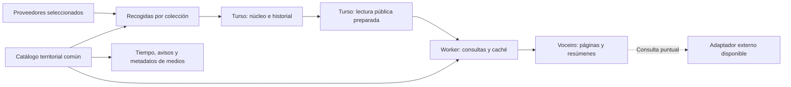

# Agenda, deportes y territorio: propuesta de arquitectura

25/10/2026. Revisión del [PR 141](https://github.com/thendabs1/voceiro/pull/141),
de las [consultas pendientes](investigacion/08-consultas-calendario-pendiente.md)
y de la implementación actual. Planteamiento acordado; primer incremento en
`shared/territorios/` y `agenda/retencion.py`. No activa migraciones, proveedores,
tareas ni despliegues nuevos.

## Alcance aclarado con el usuario

- Primera fase deportiva: calendarios, resultados y clasificaciones con
  recogidas periódicas. Los marcadores en directo quedan para después.
- Municipios como primer paso hacia códigos comunes y reutilizables entre
  servicios. La interfaz para fijar o seguir recintos sigue sin decidir.
- Se conservan los recintos acreditados que ya aportan las fuentes, sin
  exigirlos para importar un evento. La búsqueda por distancia queda fuera
  de esta primera fase.
- La lectura de noticias mantiene R2 y Google News. La conexión territorial
  debe poder aprovechar sus metadatos sin reconstruir el archivo de noticias.

## Qué hay y dónde aparece el límite

| Parte | Comprobado en el código | Consecuencia |
| --- | --- | --- |
| Navegador | `front/app/14-calendario.js` descarga `calendario.json` y construye filtros y vistas sobre todo el conjunto. | Paginar visualmente no reduce descarga ni memoria de datos. |
| Último PR | Reutiliza `Intl`, evita conversiones y ordenaciones repetidas y conserva el catálogo de filtros. CI `test` y `fuentes` correctas en el commit `b4c9c5c`. | Es una mejora local aprovechable. La medición anotada de 3.724 eventos/9,6 MB no acredita rendimiento de una futura API. |
| Estado | Turso dedicado, esquema 4, núcleo v2 con entidades, referencias, observaciones, relaciones y selección por bloques. | Ya existe el modelo de escritura; conviene ampliarlo. |
| Lectura de la base | `almacen.CONSULTAS` y `almacen_nucleo.CONSULTAS` cargan colecciones completas, incluidos documentos y observaciones. `nucleo.consultar` trabaja en memoria. | Reutilizar esa carga en cada petición trasladaría el problema al servidor. Las recogidas también crecerían con el historial. |
| Índices | Hay fechas civiles/UTC en `agenda_tiempos`. Las tablas `agenda_evento_tema` y `agenda_evento_region` corresponden al piloto. | Los índices del piloto no cubren por sí solos todos los eventos del núcleo, incluidos Madrid, Kulturklik y nuevos deportes. |
| Recogidas | El workflow diario recoge Galicia, Madrid y Kulturklik a las 04:30 UTC. FEB y ATP/WTA son opciones manuales. Madrid/Kulturklik recorren sus catálogos antes de filtrar fechas. | Incorporar fuentes exige controlar páginas y trabajo por colección. Los metadatos que aún dicen `recogida_manual` no reflejan el cron cultural. |
| Tiempo y avisos | Catálogo AEMET con INE de cinco cifras, coordenadas y zona de avisos; sitios guardados localmente. | Es un consumidor inicial del catálogo territorial común. |
| Medios | `medios.py` conserva `region`, `pais` y `ambito`; el catálogo compacto publicado pierde esos campos explícitos. | El enlace territorial necesita publicar metadatos del medio, sin reescribir millones de artículos. |

Algunas notas anteriores describen fases ya superadas: Galicia y Madrid ya
tienen adaptadores y recogida programada. Las afirmaciones antiguas sobre
ausencia de UI, publicación o recolectores no describen todo el estado actual.

## Flujo recomendado

Empezar con la base de calendario existente y tablas de lectura derivadas.
La historia conserva la evidencia; la lectura contiene únicamente el estado
público seleccionado. Así se conserva una sola autoridad y se puede regenerar
la lectura. Separarla físicamente en otra base solo tendría sentido si las
mediciones de carga, cuotas o aislamiento lo justifican.

Recomiendo añadir rutas a `cf-datos` y `deno-datos`, con implementación común
en `workers/comun/`, aprovechando los despliegues y el respaldo existentes.
El calendario tendrá su propio estado de conexión en el cliente: un fallo
de agenda no debe obligar a cambiar el backend de todas las noticias.

R2 puede alojar lecturas acotadas de respaldo si hacen falta después. Partir
todo por día, deporte y territorio desde el principio multiplica objetos y
combinaciones de filtros. El primer candidato es SQL indexado con caché;
antes de activarlo se medirán consultas reales, especialmente las de texto.

## Qué unificar

| Concepto compartido | Regla |
| --- | --- |
| Identidad y procedencia | ID estable, referencia externa contextualizada, evidencia y observación. Mantener los IDs existentes y permitir correspondencias revisables. |
| Territorio | Un catálogo común con códigos externos tipados, jerarquía administrativa y correspondencias por proveedor. |
| Temas | Reutilizar `shared/catalogo-tematico.json`. Deporte, circuito, temporada, edad y nivel siguen siendo dimensiones diferentes. |
| Tiempo | Conservar fecha civil, instante, zona, precisión, certeza y reglas de programación. |
| Fuente y colección | Compartir capacidades, alcance, frescura, cuotas y estado de las recogidas; separar la identidad del proveedor de cada flujo concreto. |
| Consulta | El parser y los controles de la UI producen la misma selección estructurada. |
| Preferencias | Guardar un objetivo, seguir cambios y elegir servicios son acciones distintas. La interfaz territorial se diseñará después de establecer los códigos. |

Se mantienen las entidades del núcleo: evento, actividad, agrupación,
participante, lugar y territorio. Resultados y clasificaciones conservan su
estructura específica. Unificar no exige convertir previsiones, avisos,
tablas deportivas o artículos en eventos de calendario.

### Catálogo territorial

Un ID interno estable representa el territorio. Sus identificadores externos
conservan sistema, código como cadena, contexto, vigencia y procedencia. INE de
cinco cifras será la clave de intercambio inicial para municipios españoles;
no se usará el nombre visible como clave.

El [INE](https://www.ine.es/dyngs/INEbase/operacion.htm?c=Estadistica_C&cid=1254736177031&idp=1254734710990)
publica cinco cifras municipales y una sexta de control, además de modificaciones
durante el año. La correspondencia gallega de seis a cinco cifras se validará
contra esa relación, conservando control y ceros iniciales. NORA conservará
provincia y municipio en su espacio de códigos hasta verificar su cruce con
INE; existe una [API oficial de NORA](https://www.euskadi.eus/gobierno-vasco/-/api-rest-nora/),
pero esta revisión no ha validado una correspondencia completa.

Recursos compartidos (primer catálogo implementado; proyecciones SQL pendientes):

- Catálogo versionado de territorios y relaciones administrativas, accesible
  desde Python y JavaScript. Las tablas SQL y el autocompletado serán
  proyecciones generadas de esa misma versión.
- Correspondencias externas con estado resuelto, pendiente o conflictivo.
  Las identidades territoriales actuales de agenda se conservan como alias;
  no cambian los IDs de eventos ni se pierden referencias existentes.
- Relaciones específicas con zonas de avisos AEMET y puntos de previsión.
  Una zona meteorológica no es otro nombre del municipio ni su padre
  administrativo. Se conserva la relación costera que usa el servicio actual,
  sin generalizarla a códigos desconocidos.
- Correspondencias editoriales de `region`/`pais` de los medios a territorios.
  La cobertura puede ser múltiple y no equivale al lugar de cada noticia.

El catálogo AEMET actual se contrasta con INE, sin reemplazar de golpe la
resolución del tiempo. Su aproximación al municipio más cercano —hasta 15 km
en el código actual— sirve para obtener una previsión; no acredita que una
coordenada pertenezca administrativamente a ese municipio. No se reutilizará
como prueba de localización de un evento.

Municipio de celebración, ámbito de una competición y cobertura de un medio
deben viajar con papeles diferentes. Por ejemplo, un encuentro de una liga
española celebrado en Madrid puede tener ambos territorios con significado
distinto. Filtrar «eventos celebrados en Madrid» usará la ubicación acreditada.
Los recintos se enlazan al territorio cuando existe evidencia; un nombre de
sala no basta para fusionar recintos de varios proveedores. Madrid necesitará
su correspondencia municipal explícita: el adaptador actual crea recintos,
pero no añade una entidad municipal común.

Un evento online o sin territorio resuelto sigue siendo importable. Se puede
mostrar sin atribuirle una ubicación inventada. Los territorios internacionales
admitirán otros sistemas de códigos, sin forzarlos dentro de INE.

### Lectura pública de Turso

Tablas derivadas propuestas, con nombres definitivos pendientes del primer
incremento:

- Publicación vigente: revisión, versión de contrato/catálogos y generación.
- Eventos actuales: programación seleccionada, campos temporales consultables,
  estado y tarjeta compacta. Originales e historial se leen solo al recolectar
  o revisar, nunca para construir una página pública.
- Relaciones de lectura por evento: temas, circuitos, fuentes, objetivos y
  territorios con su papel. La expansión de competición/edición y de parejas
  se prepara respetando las reglas y ámbitos ya definidos en el núcleo.
- Detalles, resultados y clasificaciones actuales por ID/ámbito.
- Cobertura por colección: alcance, ventana, última pasada completa, último
  intento, próxima revisión y error o caducidad.

La proyección aplica la selección de fuentes públicas antes de crear índices,
tarjetas, conteos o catálogos. No se filtrarán únicamente los detalles al final:
las fuentes excluidas tampoco deben aparecer indirectamente en búsquedas.

Los índices se diseñan sobre las consultas efectivas: fechas, territorio y
fecha, objetivo y fecha, tema y fecha, fuente y fecha. Su orden y número se
validarán con `EXPLAIN QUERY PLAN` y lecturas reales; añadir índices también
cuesta escrituras. No se considera resuelta la paginación por añadir `LIMIT`.

La publicación se activa atómicamente tras validar el conjunto. Cada respuesta
lee una revisión coherente y el cursor la identifica. Si cambia entre páginas,
la API pide reiniciar la consulta y el cliente lo explica; inicialmente basta
con conservar la lectura vigente. Retener publicaciones anteriores se valorará
si los reinicios resultan frecuentes. No se mezclan páginas o detalles de
publicaciones diferentes.

## Contrato de consulta propuesto

| Recurso | Respuesta acotada |
| --- | --- |
| `/calendario/eventos` | Agenda con ventana, filtros y cursor; 20 tarjetas por página inicialmente, máximo propuesto de 50. |
| `/calendario/resumen` | Hasta 42 días para semana/mes, conteos y un máximo pequeño de muestras por día. |
| `/calendario/eventos/:id` | Detalle y referencias necesarias para esa ficha. |
| `/calendario/clasificaciones` | Última tabla del ámbito solicitado, con paginación si hace falta. |
| `/calendario/catalogo` | Temas/fuentes pequeños y búsqueda paginada de objetivos; no todas las entidades. |
| `/territorios` | Resolución por código y sugerencias acotadas; comparte códigos con el tiempo. |

Fechas de la API en intervalos `[desde, hasta)`. Las ventanas inclusivas de
los importadores se convierten en sus adaptadores. Agenda y resumen comparten
filtros, versión y semántica. Las respuestas incluyen revisión, generación,
cobertura/frescura y continuación; «sin resultados» no significa «el proveedor
no tiene eventos» si esa ventana o colección no está cubierta.

Se conserva «Ver más» para acumular páginas, con un límite de memoria y vuelta
a la selección anterior. Semana/mes no descargan todos los detalles. Las
programaciones prolongadas aparecen una vez en agenda y en sus días válidos
del resumen, conservando el mismo ID. Las fechas pendientes tienen una lista
separada y paginada; no se esconden ni se asignan a hoy.

### Parser y exactitud de filtros

Reutilizar `shared/parser.js`, `shared/busqueda/texto.js` y
`shared/calendario/consulta.js` en cliente y worker. Ya existe compilación
FTS en el módulo de texto. Los filtros resueltos y la consulta escrita generan
un contrato normalizado; el worker lo vuelve a validar. No se admite SQL del
cliente ni se reimplementa el lenguaje en Python.

Hay que preservar frases, prefijos de palabra, exclusiones, circuitos
combinables y cruces entre filtros. Las fechas de una consulta de calendario
se refieren a celebración; las de noticias, a publicación. No se reaprovecha
`region` de Google News como identificador territorial interno. Los nuevos
prefijos territoriales se acordarán después; los códigos comunes no dependen
de inventar sintaxis ahora.

Todos los predicados deben aplicarse antes de cerrar una página, cursor o
conteo. Filtrar en JavaScript después de pedir 20 filas SQL produciría páginas
incompletas y continuaciones incorrectas. FTS tampoco garantiza bajo consumo:
hay que medir búsquedas amplias y las que solo contienen exclusiones. Cuando
una consulta supere el presupuesto, se pide acotarla; no se ignoran filtros ni
se devuelve un vacío como si fuera completo.

La consulta temporal combinará candidatos por instante UTC y por fecha civil,
con las reglas comunes para descartar falsos solapamientos. Los límites de día
se calculan en la zona solicitada, incluidos días de 23/25 horas. Días permitidos,
exclusiones, fin exclusivo y horas pendientes forman parte del filtrado, no
solo de la presentación. Un índice por día, si lo justifican las mediciones,
será derivado y de horizonte acotado; no creará funciones que la fuente no
declara ni duplicará identidades de exposiciones.

### Caché, respaldo y coste

La clave de caché incluye consulta normalizada, zona, idioma cuando afecte a
la respuesta y revisión. El TTL no reemplaza la fecha de comprobación del
proveedor. Se conserva la última lectura válida cuando falla una recogida,
indicando su antigüedad. Las peticiones al cambiar filtros se cancelan y las
respuestas antiguas no sobrescriben la selección nueva.

El worker tendrá token Turso de
[solo lectura](https://docs.turso.tech/cli/db/tokens/create), parámetros
enlazados, ventanas y tamaños máximos, plazo de consulta y límites de tráfico
antes de tocar la base. El token permanece en el servidor. CORS no sustituye
estos límites. CF y Deno respetan el mismo presupuesto; un 429 no debe disparar
un reintento en el otro backend.

La [Cache API de Cloudflare](https://developers.cloudflare.com/workers/runtime-apis/cache/)
es local al centro de datos. Ni esa caché ni los contadores en memoria actuales
garantizan un límite global de consumo. El presupuesto se estima con peticiones
sin caché × filas examinadas, sumando revalidaciones, recogidas y escrituras;
después se contrasta con el uso medido. Turso documenta que
[las filas examinadas pueden superar las devueltas](https://turso.tech/blog/tips-for-maximizing-your-turso-billing-allowances-48a0fca163e9).
Uso y consultas costosas se pueden revisar mediante las APIs de
[usage](https://docs.turso.tech/api-reference/databases/usage) y
[stats](https://docs.turso.tech/api-reference/databases/stats), con credenciales
de gestión. Esta revisión no ha consultado el presupuesto real de la cuenta
ni certifica un coste mensual. Una base dedicada facilita atribuir consumo;
no se presupone que aporte una cuota adicional independiente dentro del plan.

## Recogidas que puedan crecer

Registrar proveedor y colecciones independientes: agenda territorial, liga y
temporada, circuito, resultados o clasificaciones. Cada colección declara
capacidades, ventana alcanzable, páginas, cuota, cadencia, política de
revalidación, condiciones de uso y reglas de publicación. La procedencia no
se deduce del dominio ni de una etiqueta genérica «deportes».

Mantener Actions y los recolectores Python inicialmente. Cambiar el servidor
de lectura no obliga a reescribir adaptadores ni a moverlos todos a un cron de
Workers. El trabajo programado procesa solo colecciones vencidas y limita
peticiones y filas; si el volumen lo requiere, se podrán separar trabajos sin
cambiar el contrato público.

Cada colección valida toda su paginación antes de confirmar su pasada. Una
fuente que falla conserva su estado anterior; otras colecciones completas
pueden avanzar. La publicación declara qué pasada de cada una contiene. Los
cursores o marcas incrementales solo avanzan tras confirmar la escritura.
Se conserva el control de revisión frente a escritores concurrentes y el
tratamiento actual de respuestas perdidas tras COMMIT: no repetir escrituras
a ciegas.

El repositorio de escritura deberá poder cargar referencias afectadas, estado
actual y dependencias necesarias, y añadir observaciones por cambios. El
historial completo queda para auditoría/recuperación. La construcción de la
lectura tampoco debe revalidar y reconstruir toda la historia cada vez. Ese
cambio se entrega de forma gradual con comparación de estados; no se elimina
el historial para acelerar las recogidas.

Como punto de partida a medir: cultura diaria; calendarios deportivos varias
veces al día según proveedor; resultados de jornadas recientes con mayor
frecuencia y revisión posterior; clasificaciones tras cambios relevantes.
Son políticas propuestas, pendientes de cuotas y cobertura de cada servicio,
no nuevos compromisos de frescura. Sin directo no hace falta sondear todos los
encuentros continuamente.

Ausencia no equivale a cancelación. El estado de cobertura permite distinguir
datos vistos anteriormente, revalidados, fuera de la última ventana y antiguos.
Un incremental sin eliminaciones necesita revisiones completas periódicas
cuando el proveedor lo permita. La ventana pública, el alcance de recogida y
la retención histórica son tres decisiones diferentes. Se acuerda un máximo de
45 días para eventos puntuales terminados; temporadas, resultados, clasificaciones
y entidades reutilizables tendrán políticas propias. El primer incremento solo
prepara un informe de candidatos con final confirmado. La poda necesita resolver
dependencias exclusivas y documentos compartidos de forma transaccional y evitar
reimportaciones de eventos ya caducados; no se activa automáticamente.

## Consultas puntuales a proveedores

La recogida compartida da servicio a las selecciones habituales de Voceiro.
Una consulta externa complementa ámbitos que no recolectamos o datos más
específicos. Se indica fuente, momento, alcance y si el resultado está guardado
o procede de una consulta puntual. No se promete seguimiento persistente de
un resultado que solo vive en el navegador.

La vía concreta depende de cada proveedor:

- Navegador directo si hay CORS, acceso público sin secretos y condiciones
  compatibles. La consulta se inicia por acción del usuario, no por cada tecla.
- Adaptador del worker para APIs sin CORS o con credencial, presupuesto propio
  y destinos/rutas permitidos. Nunca un proxy de URLs arbitrarias. Las cuotas
  del servidor se comparten entre sus usuarios.
- Enlace al servicio original cuando no se pueda integrar la consulta.

Compartir el normalizador facilita presentar los resultados con el mismo
contrato, pero no los convierte automáticamente en registros persistentes.
Si coinciden varias fuentes, solo una correspondencia explícita permite
unificarlas; no se fusionan por título, equipos literales y hora aproximada.

### SportsEvents24: resultado de esta revisión

La [documentación](https://sportsevents24.com/api) y el
[OpenAPI](https://sportsevents24.com/api/openapi.json) publican acceso anónimo,
100 consultas/día/IP, 10/minuto y 5.000 filas/mes/IP, incluidas filas repetidas
y torneos. Ventana de siete días pasados a treinta futuros; `to` exclusivo;
`updated_since` no comunica eliminaciones. No admite descargas masivas sin
selección.

Se hicieron dos GET acotados de una fila de baloncesto español, el segundo con
`Origin: https://voceiro.eu`: HTTP 200, JSON y cursor; sin
`Access-Control-Allow-Origin` y con `Cache-Control: no-store`. Hoy esa respuesta
no permite el `fetch` ordinario desde Voceiro. Abrir la URL en otra pestaña
no demuestra CORS. No se ha probado una integración en navegador.

La muestra aporta IDs de evento/torneo, pero equipos y sede como literales.
`category: result` viene con resultado vacío: no basta para declarar marcador
final. Son necesarios adaptador, revisión de semántica y condiciones para la
persistencia/publicación previstas.

Ejemplo de presupuesto, no consumo medido: 500 filas × dos repasadas diarias ×
30 días = 30.000 filas mensuales. Por eso esta beta parece más adecuada para
selecciones pequeñas o consultas puntuales que para recolectar todos los
deportes. No se planifica distribuir peticiones entre IP para ampliar cuotas.

Se mantienen los estados previos de las demás fuentes: no se reabre FotMob
mientras se espera la respuesta solicitada, y no se reactiva OpenF1. Los
adaptadores deportivos existentes no se convierten automáticamente en fuentes
públicas o periódicas al desplegar esta arquitectura.

## Orden de cambios propuesto

1. **Códigos comunes y contratos.** Catálogo territorial versionado, cruces
   iniciales verificables y contrato de consulta/cobertura. La función de fijar
   sitios o recintos no es requisito para completar este paso.
2. **Lectura indexada y API.** Proyección pública aditiva en Turso, rutas
   comunes CF/Deno y comparación con la selección actual. Medir SQL y memoria
   antes de cambiar el frontend.
3. **Cliente acotado.** Agenda paginada, resúmenes de semana/mes, detalles y
   catálogos bajo demanda. Conservación de selección, accesibilidad y respaldo.
   Activación reversible, con un período de compatibilidad del JSON actual.
4. **Recogidas incrementales y operación.** Retirar la carga de toda la
   historia del camino habitual; estado por colección, errores independientes
   y presupuesto. Completar antes de multiplicar fuentes o cadencias.
5. **Ampliar servicios y conexiones.** Nuevos proveedores uno a uno; relación
   con tiempo, avisos y cobertura de medios mediante los mismos códigos.
   Consultas externas según capacidades reales. Después se diseña la interfaz
   de sitios fijados y sus preferencias.

Cada incremento conserva los IDs y se puede revisar por separado. El PR 141
puede seguir limitado a su arreglo local; esta propuesta no implica mezclar
toda la migración con ese cambio ni fusionarlo sin indicación.

## Condiciones para activar la nueva lectura

- Equivalencia con muestras culturales y deportivas: IDs, traducciones,
  participantes, parejas, resultados y fuentes publicables.
- Consultas con frases/exclusiones, filtros combinados y paginación sin
  pérdidas ni duplicados, incluidos cambios de revisión y fechas pendientes.
- Solapamientos, días excluidos, fin exclusivo, Canarias y cambios de hora;
  el resumen de un día coincide con su agenda filtrada.
- Códigos con ceros iniciales, homónimos, correspondencias pendientes y cambios
  territoriales; una ubicación no hereda indebidamente el ámbito de una liga.
- Fallo de proveedor, página repetida/incompleta, 429, caída CF/Deno, respuesta
  antigua del cliente y concurrencia de escritores sin pérdida de estado.
- Comparación de bytes, tiempo, memoria, filas leídas/escritas y número de
  peticiones con el volumen actual y crecimiento sintético. Los presupuestos
  concretos se fijan con esas mediciones, no solo con el número de filas devueltas.

Verificado para esta revisión: lectura del PR y código, estado de sus dos
checks en GitHub, documentación primaria y dos consultas externas acotadas.
Ejecutados localmente los dos archivos de pruebas
`tests/busqueda/calendario.test.mjs` y `tests/ui/calendario.test.mjs`, correctos.
No se ha ejecutado localmente la suite completa, que corresponde a CI; tampoco
se ha medido una API aún inexistente ni modificado Turso o producción.
