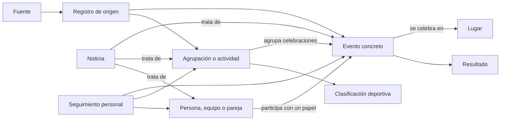

# Revisión del modelo común — propuesta para acordar

Estado: **diseño, sin migración ni cambio del contrato vigente**. Se parte del
piloto Galicia/Vidmar, de los casos deportivos ya observados y del
[nuevo contraste de fuentes](investigacion/07-multideporte-y-seleccion.md).
No presupone que todas esas fuentes vayan a integrarse.

La continuación concreta el [núcleo con FEB, tenis y noticias ESPN](diseno-nucleo.md):
relaciones mínimas, referencias de competición/edición/cuadro/encuentro y
comprobaciones de diseño. El modelo todavía no está cerrado; enumerar estas
entidades no basta para pasar a migración.
El [contrato lógico propuesto](contrato-propuesto.md) desarrolla campos,
cardinalidades y clasificación común; la conexión con noticias concretas
puede incorporarse después sin bloquear el núcleo.
Las [decisiones del modelo](decisiones-modelo.md) concretan el catálogo, las
reglas pendientes y el almacenamiento; su clasificación común ya se implementa.

## Qué conservar y qué revisar

Conservar IDs independientes del título y horario, originales, observaciones,
historial, precisión temporal y ausencia distinta de cancelación. La base
actual ya resuelve esas garantías para sus dos adaptadores.

Revisar antes de ampliar: un registro externo siempre apunta a un evento;
el evento tiene un único lugar y una única precisión para inicio/fin; tipos,
ciclos y fichas comparten `grupos`; no hay participantes, resultados ni tablas
consultables. `datos_de` elige una referencia estable por orden, sin política
de autoridad entre proveedores. El historial de registros todavía no es una
lista de novedades relevantes para quien sigue un evento.

## Entidades y relaciones propuestas

Son responsabilidades lógicas; esta tabla no obliga a crear una tabla SQL
para cada fila ahora.

| Concepto | Responsabilidad y ejemplo |
| --- | --- |
| Fuente / flujo | Quién publica y qué selección ofrece, capacidades, cobertura, condiciones y atribución. Un formato o filtro alternativo no crea otra identidad del hecho. |
| Registro de origen | ID con su espacio de nombres, datos originales o referencia al documento recogido, modificación declarada y primera/última observación. |
| Actividad / obra | Contenido que puede celebrarse varias veces: obra de teatro o exposición itinerante. No confundir con el tipo «teatro». |
| Agrupación identificada | Ciclo, festival, campeonato, edición/temporada, fase o cuadro. Tipo explícito y relaciones, sin exigir la misma jerarquía en todas las disciplinas. |
| Evento / celebración | Función, encuentro o sesión concreta que se puede guardar y cuyo horario puede cambiar conservando identidad. Puede ser un intervalo continuo. |
| Participante / agente | Persona, club, equipo inscrito, pareja u organización; identidad propia y relaciones temporales cuando se conozcan. No equiparar automáticamente el club con sus equipos femenino/masculino/cantera. |
| Participación | Relación con el evento y papel: intérprete, competidor, organizador, local/visitante cuando proceda. Admite muchos participantes y plazas pendientes sin inventar personas. |
| Lugar / territorio | Recinto, municipio, región y país; referencias verificadas. La sede de un participante, el ámbito de una competición y el lugar de celebración son relaciones diferentes. |
| Tema / clasificación | Vocabulario de origen y correspondencia revisada con temas compartidos: teatro, baloncesto, automovilismo. Las categorías competitivas van en ejes propios. |
| Resultado | Datos deportivos por fuente y evento: parciales, unidades, ganador, condición provisional/final y rectificaciones. No imponer dos números a todos los deportes. |
| Clasificación deportiva | Instantánea por competición/edición/fase/grupo/ámbito con filas, orden, métricas y observación. No es un evento nuevo. |
| Relación con noticia | Un artículo puede tratar una celebración, una competición, una persona o un equipo; relación con procedencia y estado de revisión. |
| Seguimiento personal | Objetivo estable, preferencias de novedades y estado de lectura; separado del catálogo compartido y de la recogida. |

No se obliga a que una carrera, un torneo o un festival se represente siempre
solo como grupo o solo como evento. Su edición puede agrupar celebraciones y,
si existe una programación global fiable, ofrecer también un intervalo de
agenda vinculado a la misma entidad. Evitar dos objetos sin vínculo que el
usuario no pueda reconocer como el mismo objetivo de seguimiento.

## Casos concretos que debe poder expresar

| Caso | Representación que debemos poder comprobar |
| --- | --- |
| Teatro gallego ya integrado | Ficha/obra con varias funciones distintas; títulos traducidos del mismo evento; municipio de cada función; tipo «teatro» separado de la ficha. |
| Festival catalán observado | Código `20230607008`: 429 filas, con varias localizaciones y repeticiones dentro del mismo espacio. Intervalo global del festival; no hay información suficiente para fabricar 429 funciones. |
| Agenda madrileña observada | `ID-EVENTO: 50382736`: intervalo de dos días, `HORA: 20:00`, días de semana y fin a las 23:59. Distinguir la ficha y sus reglas de asistencia del supuesto fin de una función. |
| Tenis WTA observado | Torneo/edición → cuadro individual o dobles → encuentro. Dos personas o dos parejas; integrantes de pareja; ronda, pista y horario todavía pendiente cuando lo declare la fuente. |
| NBA observada | Liga → temporada declarada → fase → encuentro. Octubre de 2026 puede pertenecer a `season.year: 2027`; no derivar la temporada de la fecha. |
| Baloncesto territorial observado | Partido con ID y torneo con ID aunque solo conozcamos nombres de equipos. Se puede guardar el partido; seguir al equipo exige resolver antes su identidad. |
| F1 actual y posible contraste | Campeonato/edición → gran premio → sesiones. Los UID de Vidmar y las referencias de otro proveedor necesitan correspondencia documentada; nombre y fecha no bastan. |
| Torneo online Lichess observado | Inicio/fin y enlace online sin territorio físico obligatorio. Variante y ritmo son propiedades distintas del estado de celebración. |
| Noticia relacionada, caso de diseño | Una crónica de un encuentro puede enlazar ese evento; una noticia de fichajes enlaza al equipo. Coincidir en «baloncesto» no acredita ninguna de esas relaciones concretas. |

El ejemplo anterior de noticias es un escenario de diseño. La ampliación ESPN
sí comprobó relaciones declaradas por el proveedor entre artículos y entidades;
no existe todavía extracción implementada ni un catálogo interno de enlaces
revisados. Las muestras y límites de
Cataluña/Madrid y FEB se detallan en sus informes de investigación.

## Tiempo, varias localizaciones y ocurrencias

Separar intervalo de publicación, intervalo de actividad y citas de asistencia.
Una exposición abierta durante un mes no tiene una cita diaria por defecto.
Las sesiones explícitas son ocurrencias; un texto «de martes a domingo» queda
como horario textual hasta disponer de reglas y excepciones comprobables.

La precisión y certeza deben poder distinguir inicio y fin. Tener una fecha
con componente de hora no prueba que esa hora sea válida. Guardar el marcador
original y sus señales; no transformar `TBD` en una hora ni dar por fiable
el día si la fuente no permite establecerlo. Conservar fecha oficial de la
competición además del instante y la zona cuando estén declarados.

Varias ubicaciones de una ficha no prueban celebraciones simultáneas ni una
gira. Necesitamos asociar lugar y período cuando la fuente los empareje.
Una fila por localización no puede generar por sí sola otro evento. Los
intervalos se consultarán por solapamiento con semana/mes, con fines exclusivos
según fuente y sin convertir fechas sin hora en medianoche UTC.

## Lugares y categorías compartidos con tiempo y medios

Reutilizar identificadores comunes mediante correspondencias verificadas,
manteniendo los de cada proveedor. El tiempo usa INE municipal de cinco cifras;
Galicia conserva seis con control. La correspondencia se valida contra el
catálogo oficial, incluidos ceros iniciales. Las coordenadas cercanas y el
nombre sirven para sugerir una correspondencia, no para confirmarla solos.
Los lugares internacionales necesitan otros sistemas de referencia.

La jerarquía administrativa y las zonas meteorológicas se relacionan sin
declararlas equivalentes. El catálogo AEMET actual ayuda a empezar, pero no
es por sí mismo una autoridad mundial de recintos y territorios.

Para clasificar, conservar tres capas: valor literal de origen, correspondencia
editorial con un vocabulario pequeño y evidencia de cualquier enriquecimiento.
Separar tema/deporte, modalidad, categoría de participación, edad, nivel
competitivo y ámbito territorial. No fabricar datos ausentes desde nombres.
En medios, sector y cobertura describen a la publicación; no clasifican
automáticamente cada artículo o evento que menciona.

## Origen, identidad y autoridad

Una descarga puede contener muchas entidades. En tenis, el documento incluye
torneos, cuadros y encuentros. Separar documento descargado de registro lógico
extraído; este último necesita tipo, ID completo y ruta al original. El
contrato actual `registro → evento` no basta para importar todos esos objetos.
Decidir en la primera ampliación si se generaliza el registro o se incorporan
registros de entidades por separado, conservando un documento original común.

Identidades comunes y alias no dependen del nombre, fecha, ruta de consulta ni
posición de una fila. Donde el proveedor no declare ID, marcarlo como límite:
no prometer seguimiento de equipos usando nombres como identidad permanente.
Las equivalencias entre fuentes requieren evidencia, revisión y reversibilidad;
las fusiones deben conservar alias/redirecciones para no perder seguimientos.

Guardar procedencia de relaciones y decisiones editoriales fuera de los campos
que el importador reconstruye en cada pasada. Para discrepancias entre fuentes,
definir autoridad por dato y mantener el conflicto: no usar el orden alfabético
de `datos_de` como política final ni mezclar un marcador con un estado de otra
fuente sin explicitarlo. Las condiciones pueden variar por flujo y por contenido
(por ejemplo, datos frente a imágenes), no solo por nombre de proveedor.

## Guardar, seguir y noticias

Guardar una cita y seguir sus novedades son acciones distintas. Seguimiento
con objetivo tipado y estable: evento, competición/ciclo, equipo o persona.
Dos preferencias independientes, confirmadas por el usuario: cambios del
calendario y noticias relacionadas. Los recordatorios de proximidad necesitan
su propia preferencia; el canal de entrega todavía no está decidido.

Un seguidor de un campeonato puede recibir novedades de sus eventos hijos,
pero cada novedad se identifica una sola vez aunque siga también al equipo.
Separar revisiones de contenido relevantes, observaciones técnicas y estado
visto por el usuario. Una descarga idéntica no produce una novedad; no activar
avisos en cada cambio de marcador sin acordar esa preferencia.

Para noticias, relación muchos-a-muchos, objeto concreto y evidencia. Separar
origen —declarado por proveedor o inferido— de estado de revisión editorial.
Una coincidencia temática puede sugerir; no acredita el enlace. Usar referencia
persistente de artículo, con ID de origen cuando exista y URL normalizada con
política de alias, sin IDs derivados del índice del feed o del título.

La sincronización cifrada actual solo conserva sus bloques conocidos: los
seguimientos usarán un documento cifrado separado y fusión por campos, con
bajas sincronizables y compatibilidad entre versiones. No insertar estos objetos en «pendientes»
como si fueran URLs de noticias. Tampoco trasladar ahora las bases de tiempo,
medios y calendario: compartir referencias no exige unir su almacenamiento.

## Siguiente incremento propuesto

1. Revisar juntos las entidades y relaciones anteriores con ejemplos reales
   de una segunda agenda cultural y de baloncesto/tenis. Resolver qué dato es
   una cita y qué es una ficha, edición, localización u horario.
2. Revisar el contrato conjunto y preparar su correspondencia con el esquema
   vigente, conservando IDs, originales e historial. Incluir la clasificación
   temática compatible con medios y temas existentes; implementar los enlaces
   a artículos en otro incremento. Elegir el siguiente adaptador después de
   concretar esa compatibilidad y sus condiciones de uso.
3. Definir consultas por solapamiento temporal y referencias, presupuesto de
   lectura/revalidación y vistas exportables. Después diseñar semana/mes y
   los controles de guardar/seguir sobre el mismo contrato.

Resultados y clasificaciones quedan definidos como conceptos separados;
su implementación puede llegar después de citas/participantes. Este documento
no decide todavía todos sus campos, las reglas de conciliación ni el sistema
de entrega de novedades.
